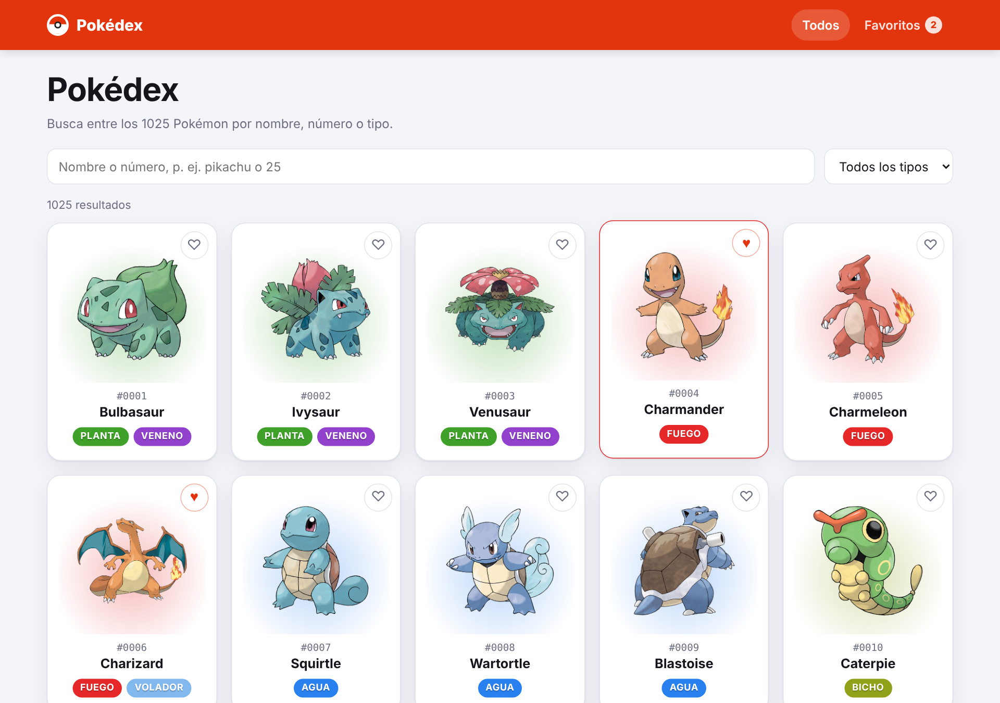
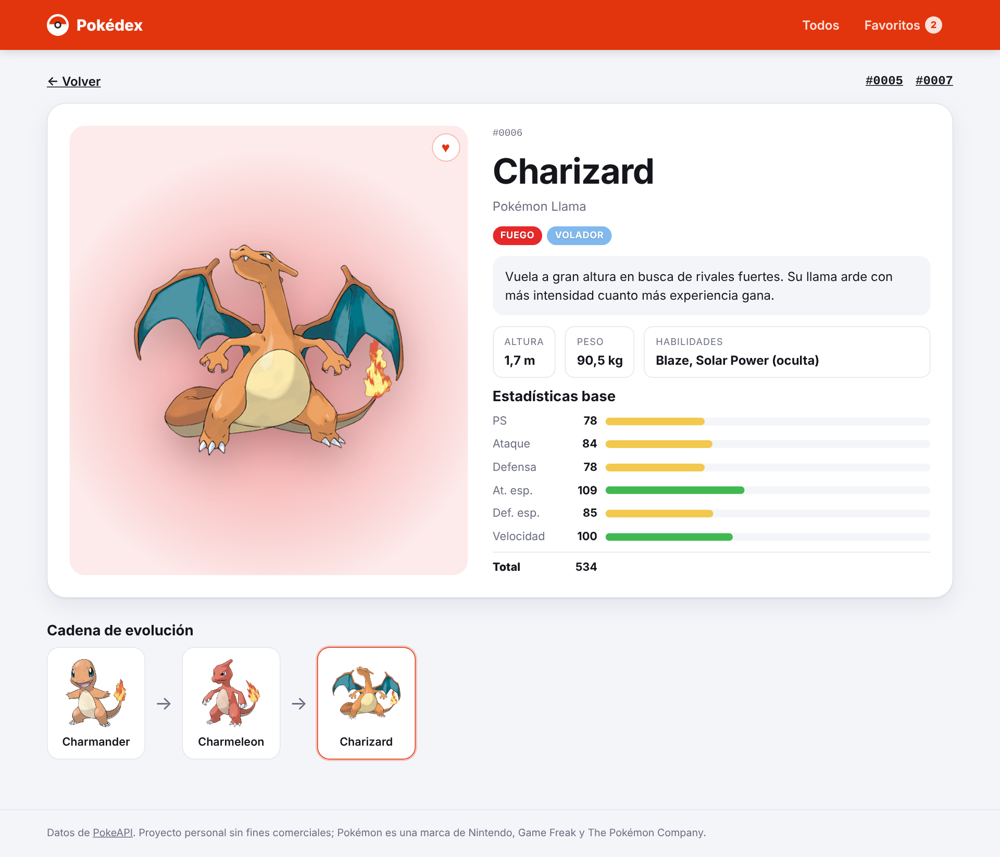

# Pokédex · React + TypeScript + TanStack Query

Pokédex con los 1025 Pokémon que consume la [PokeAPI](https://pokeapi.co): búsqueda por nombre o número, filtro por tipo, paginación, ficha con estadísticas y cadena de evolución, y favoritos guardados en el navegador.



## Funcionalidades

- **Búsqueda instantánea** por nombre o número (`pikachu`, `25`, `#025`, `mr mime`).
- **Filtro por tipo** (Fuego, Agua, Planta…) combinable con la búsqueda.
- **Paginación** de 24 en 24. Búsqueda, tipo y página se guardan en la URL.
- **Ficha** con nombre y descripción en español, altura, peso, habilidades, estadísticas base en barras y **cadena de evolución** (incluidas las ramas, como Eevee).
- **Favoritos** guardados en `localStorage` y sincronizados entre pestañas.
- Estados de **carga y error con reintento**, y página 404 para números que no existen.
- Diseño **responsive** con **modo oscuro** automático.
- **Tests unitarios** de búsqueda, paginación y cadena de evolución con Vitest.

## Tecnologías

React 19 · TypeScript · Vite · TanStack Query · React Router · Vitest · CSS propio · GitHub Pages

## Cómo está organizado

```
src/
├── api/
│   ├── pokeapi.ts        # Llamadas a la PokeAPI y manejo de errores
│   └── types.ts          # Tipos de las respuestas de la API
├── hooks/
│   ├── queries.ts        # Hooks de TanStack Query con caché
│   ├── FavoritesProvider.tsx
│   └── useFavorites.ts
├── lib/pokemon.ts        # Lógica pura: filtros, paginación, evolución, tipos en español
├── components/           # Tarjeta, insignia de tipo, barra de estadística, paginación…
└── pages/                # Pokédex, ficha, favoritos y 404
```

### Decisiones técnicas

- **TanStack Query** para las peticiones: caché de 24 h (los datos de la PokeAPI casi no cambian), estados de carga y error, y reintento automático.
- **Un solo índice ligero** (`/pokemon?limit=1025`) para buscar y paginar en el navegador, sin una petición por cada letra escrita. Los detalles de cada tarjeta se piden solo para la página visible.
- **El filtro por tipo** usa el endpoint `/type/{tipo}` y se cruza con el índice como un `Set`, así la búsqueda sigue siendo instantánea.
- **Lógica pura separada de los componentes** (`lib/pokemon.ts`), fácil de testear.

## Ejecutar en local

```bash
npm install
npm run dev      # servidor de desarrollo
npm test         # tests unitarios
npm run build    # versión de producción
npm run deploy   # publicar en GitHub Pages
```

## Capturas

| Filtro por tipo | Ficha y evolución |
| --- | --- |
|  |  |

---

Datos de PokeAPI. Proyecto personal sin fines comerciales; Pokémon es una marca de Nintendo, Game Freak y The Pokémon Company.
